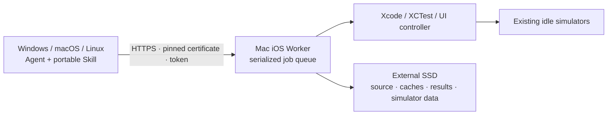

# iOS Worker

**Use a Mac as a private iOS build and test worker from Windows, macOS or Linux.**

[English](README.md) · [简体中文](README.zh-CN.md)

Develop on your preferred computer, send the current working tree to your Mac, and build, test, explore simulator UI and collect evidence through an authenticated HTTPS API. A portable Agent Skill wraps the API with Python or PowerShell; clients do not need Xcode, SSH or MCP registration.



This repository contains source code and example configuration only. **Generate your own credentials and certificate.** Owner-generated client bundles contain secrets and must stay private.

## What it does

| Capability | Details |
|---|---|
| Build and test | Simulator builds, XCTest/XCUITest, targeted tests, unsigned Release Archives and artifact downloads |
| Incremental source sync | Includes uncommitted changes; uploads missing file content by SHA-256; stable build workspace and reusable caches |
| Persistent development sessions | Device reservations, app installation/relaunch, continuous exploration and tests on the same owned simulator |
| Interactive UI | Accessibility tree, element queries, tap, type, clear, swipe, scroll, wait and rotation |
| Runtime diagnostics | App logs/stdout/stderr, process stack samples, matching crash reports and exported test attachments |
| Screenshot matrices | Existing devices, language/locale, appearance, orientation, fixture arguments, UI steps, opaque PNGs and a ZIP manifest |
| Storage management | Usage, reviewed cache-cleanup plans and source-retention plans, busy-session locks and Archive protection |
| Project preparation | Xcode/SDK/tool availability, XcodeGen projects and SwiftPM dependency resolution |
| Portable clients | Python 3.9+ standard library or Windows PowerShell 5.1/.NET 4.8 and PowerShell 7; compact job/log summaries |

The server targets macOS with full Xcode and Python 3.11+. Apple Silicon is the currently exercised host architecture. An external APFS SSD is recommended: source revisions and working copies use copy-on-write clones when available. Device registration copies and verifies an **existing idle** simulator's data onto that SSD, retaining its original data as a backup. It does not create or erase simulators.

## Quick start: Mac owner

Prerequisites: full Xcode with its initial setup completed, a compatible installed simulator runtime, Python 3.11+, Git and a mounted external SSD. XcodeGen is optional for the included sample. Keep the checkout on external storage too if internal space is limited.

1. Clone the repository and provision a **new, empty** deployment directory:

   ```sh
   git clone https://github.com/SDLi416/ios-worker.git
   cd ios-worker
   python3 scripts/provision.py \
     --root "/Volumes/BuildSSD/iOSWorker" \
     --url "https://mac-worker.example.test:9443" \
     --listen 0.0.0.0 \
     --allow-client 203.0.113.10/32
   ```

   Replace the example volume, hostname and documentation-only client IP with your actual values. The URL must resolve from the client and match the certificate. Provisioning generates independent random build/admin tokens, a certificate, a pinned volume identity and a private `Client/ios-worker` bundle. It refuses to overwrite an existing deployment. The default listener is loopback; `--listen` explicitly enables LAN access. No service or simulator is started by provisioning.

2. Install server dependencies into the external deployment:

   ```sh
   WORKER_ROOT="/Volumes/BuildSSD/iOSWorker"
   export TMPDIR="$WORKER_ROOT/Service/work/"
   export PIP_CACHE_DIR="$WORKER_ROOT/Service/work/pip-cache"
   python3 -m venv "$WORKER_ROOT/Service/venv"
   "$WORKER_ROOT/Service/venv/bin/python" -m pip install -r "$WORKER_ROOT/Service/requirements.lock"
   ```

3. For interactive UI control, prepare the pinned [WebDriverAgent](https://github.com/appium/WebDriverAgent) build:

   ```sh
   "$WORKER_ROOT/Service/venv/bin/python" scripts/prepare_ui.py --root "$WORKER_ROOT"
   ```

   This downloads upstream source and builds it on the SSD. The HTTP and MJPEG listeners used by sessions bind to **127.0.0.1**; remote clients continue through the authenticated Worker API. Builds and ordinary XCTest jobs can be used before preparing this optional controller.

4. Start the service in the foreground:

   ```sh
   "$WORKER_ROOT/Service/venv/bin/python" -B "$WORKER_ROOT/Service/src/serve.py"
   ```

   If macOS requires an app identity for removable-volume access, stop the foreground server, build the optional menu-bar launcher, then open it yourself:

   ```sh
   "$WORKER_ROOT/Service/venv/bin/python" scripts/build_launcher.py --root "$WORKER_ROOT"
   open "$WORKER_ROOT/Service/iOS Worker.app"
   ```

   Grant removable-volume access when macOS asks. You may add the app to Login Items manually. Provisioning does not change login items or system permissions.

5. Inspect `xcrun simctl list devices` and `xcrun simctl list devices booted`. Select an existing idle compatible device, then use the generated Skill's `simulators` and `register_device` operations. Registration requires the admin profile and preserves the original data. Always specify the registered device ID, or configure `default_simulator` before starting the service.

See [deployment details](docs/deployment.md) for configuration, device registration, menu-bar behavior and recovery.

## Install the Skill on a client

Privately copy the **generated** `Client/ios-worker` directory from the Mac to your client computer. It includes the correct URL, certificate, pin and tokens. The public `skills/ios-worker` folder is the generic source, without profiles.

Windows, from the directory containing that copied `ios-worker` folder:

```powershell
powershell -NoProfile -ExecutionPolicy Bypass -File .\ios-worker\scripts\install.ps1 -Upgrade
```

macOS / Linux / Windows with Python:

```sh
python3 -B ios-worker/scripts/install.py --upgrade
```

The default destination is `~/.agents/skills/ios-worker`. Use `--agent claude` / `-Agent claude` for Claude Code, or `--destination` / `-Destination` for another agent's exact Skill directory. Upgrades preserve existing private profiles and back up the previous Skill outside the skills directory. Start a new agent session, then ask it to use `ios-worker` to check `status` and `toolchain`.

The agent must be able to execute local commands and reach the Mac. Installing a Skill in a cloud-only environment does not establish a private LAN route. Environment variables `IOS_WORKER_CONFIG` and `IOS_WORKER_ADMIN_CONFIG` can select profiles stored outside the Skill.

## A development loop

Each request is one UTF-8 JSON file passed to `scripts/invoke.py --request request.json` or `scripts/invoke.ps1 -RequestFile request.json` in the installed Skill. Replace returned IDs in subsequent requests.

```json
{"operation":"sync","project_id":"my-app","source":"/path/to/git/repository"}
```

```json
{"operation":"submit","job":{"action":"build","project_id":"my-app","revision":"returned-revision","scheme":"MyApp"}}
```

```json
{"operation":"session_open","project_id":"my-app","build_job_id":"successful-build-job","simulator_id":"existing-registered-device"}
```

```json
{"operation":"ui","command":"tree","session_id":"returned-session-id"}
```

```json
{"operation":"ui","command":"tap","session_id":"returned-session-id","selector":{"value":"save-button"}}
```

After editing: sync → build → `session_install` → targeted `test` with the same `session_id` → inspect evidence → `session_close`. Job-producing commands wait internally by default and return compact results. Use `wait:false` for asynchronous work and `log` for an error-focused summary.

[Build/sync/storage operations](skills/ios-worker/references/operations.md) · [Sessions/UI/diagnostics/screenshots](skills/ios-worker/references/development.md) · [Connection troubleshooting](skills/ios-worker/references/connection.md) · [Counter sample app](examples/CounterApp/README.md)

## Storage and trust boundaries

All Worker-managed source, caches, job temporary files, controller builds, results and registered simulator data are placed under the external root. The service pins the volume UUID and owner marker and fails closed if the SSD is missing; it does not fall back to the internal disk. Xcode, installed runtimes and small macOS-managed state/logs can still consume internal space.

Cleanup is opt-in: preview exact candidates, then execute the matching unexpired plan with admin authorization. Active jobs/uploads/sessions block cleanup; Archives and original projects are excluded. Source retention protects recent/latest revisions and Archive references. APFS clones may share blocks, so preview size sums are upper bounds on reclaimed storage.

This is a **trusted single-owner / small trusted-client** service. Xcode build phases run as the Mac user, and clients sharing credentials cooperate rather than receiving hostile-tenant isolation. HTTPS certificate pinning, separate build/admin tokens, a network allowlist, simulator ownership and deletion guards support this model. Keep the service on a trusted LAN/VPN and share admin profiles only with authorized operators. Read [SECURITY.md](SECURITY.md) before deployment.

LLDB breakpoints, Instruments, physical devices, live human remote desktop, automatic provisioning/signing and release-cloud setup are outside the current implementation. Project-specific fixtures, localized content and assertions remain the app's responsibility. Screenshot checks cover format/dimensions, not App Store content approval.

## Tests and contributions

The backend safety suite uses temporary directories and a simulated volume boundary. It does not boot devices or require a real external disk. CI runs the server suite on macOS and portable client tests on Windows/Linux. See [CONTRIBUTING.md](CONTRIBUTING.md) for commands and publication checks. Private profiles, keys, machine paths, device IDs, logs and real project sources do not belong in contributions.

## License

[MIT](LICENSE). WebDriverAgent is downloaded separately and retains its upstream BSD license; see [third-party notices](THIRD_PARTY_NOTICES.md). Xcode and Apple SDKs are not distributed by this repository.
