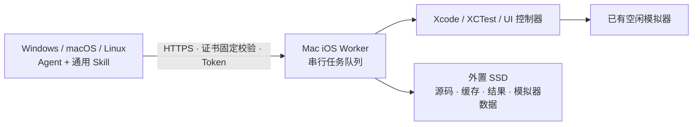

# iOS Worker

**让 Mac 成为私有 iOS 构建与测试节点，在 Windows、macOS 或 Linux 上持续开发。**

[English](README.md) · [简体中文](README.zh-CN.md)

在你习惯的电脑上修改代码，把当前工作树交给 Mac，通过带认证的 HTTPS 接口完成编译、测试、模拟器页面探索和问题诊断。通用 Agent Skill 提供 Python / PowerShell 客户端，客户端无需安装 Xcode、SSH 或配置 MCP。



仓库只包含源码和示例配置，**每个部署需生成自己的凭证与证书**。部署后生成的客户端目录包含私密配置，应当私下传递。

## 能力

| 能力 | 内容 |
|---|---|
| 编译与测试 | 模拟器构建、XCTest/XCUITest、针对性重测、未签名 Release Archive、产物下载 |
| 增量同步 | 包含未提交修改；按 SHA-256 上传缺失文件内容；固定构建工作目录，复用缓存 |
| 持续开发会话 | 记录设备归属，安装/重启 App，在同一台自己占用的模拟器上连续观察和重测 |
| 逐步操作 UI | 元素树、元素查询、点击、输入/清空、滑动、滚动、等待、旋转 |
| 运行诊断 | App 日志及 stdout/stderr、进程堆栈采样、匹配的崩溃报告、测试附件导出 |
| 多设备截图 | 复用已有设备，配置语言/地区、外观、方向、测试数据参数和页面步骤，导出无 alpha PNG 与清单 ZIP |
| 空间管理 | 用量统计、先预览再执行的缓存/源码历史清理、会话忙碌锁、Archive 保护 |
| 工程准备 | 检查 Xcode/SDK/工具，支持 XcodeGen 工程与 SwiftPM 依赖准备 |
| 通用客户端 | Python 3.9+ 标准库，或 Windows PowerShell 5.1/.NET 4.8、PowerShell 7；默认返回精简摘要 |

服务端需要 macOS、完整 Xcode 和 Python 3.11+；目前实际使用过的主机架构为 Apple Silicon。建议使用 APFS 外置 SSD：源码版本和工作副本尽可能共享写时复制的物理块。设备登记会复制并校验一台**已有空闲**模拟器的数据，将后续数据放在外置盘，同时保留原始备份；不会创建或擦除设备。

## Mac 端快速部署

准备完整 Xcode 并完成首次启动配置、兼容的已安装模拟器运行时、Python 3.11+、Git 和已挂载的外置 SSD。示例 App 另外使用 XcodeGen。内置盘紧张时，源码仓库也建议放在外置盘。

1. 克隆项目，为一个**新建的空目录**生成部署配置：

   ```sh
   git clone https://github.com/SDLi416/ios-worker.git
   cd ios-worker
   python3 scripts/provision.py \
     --root "/Volumes/BuildSSD/iOSWorker" \
     --url "https://mac-worker.example.test:9443" \
     --listen 0.0.0.0 \
     --allow-client 203.0.113.10/32
   ```

   请把示例磁盘路径、主机名和仅用于文档的客户端 IP 换成实际值。URL 必须能从客户端访问，并与证书名称一致。脚本会生成相互独立的随机构建/管理 Token、证书、磁盘身份标记和私有 `Client/ios-worker` 目录，拒绝覆盖已有部署。默认只监听本机，`--listen` 显式开启局域网监听。生成配置不会启动服务或模拟器。

2. 把 Python 环境和依赖装在外置盘：

   ```sh
   WORKER_ROOT="/Volumes/BuildSSD/iOSWorker"
   export TMPDIR="$WORKER_ROOT/Service/work/"
   export PIP_CACHE_DIR="$WORKER_ROOT/Service/work/pip-cache"
   python3 -m venv "$WORKER_ROOT/Service/venv"
   "$WORKER_ROOT/Service/venv/bin/python" -m pip install -r "$WORKER_ROOT/Service/requirements.lock"
   ```

3. 如需逐步操作模拟器，准备固定版本的 [WebDriverAgent](https://github.com/appium/WebDriverAgent)：

   ```sh
   "$WORKER_ROOT/Service/venv/bin/python" scripts/prepare_ui.py --root "$WORKER_ROOT"
   ```

   上游源码、构建产物和缓存均放在外置盘。会话中的 HTTP / MJPEG 控制端口只监听 **127.0.0.1**；远程访问仍经过 Worker 的 HTTPS 和认证。普通编译与 XCTest 可以先使用，不必等待这个可选控制器。

4. 以前台方式启动：

   ```sh
   "$WORKER_ROOT/Service/venv/bin/python" -B "$WORKER_ROOT/Service/src/serve.py"
   ```

   如果 macOS 需要通过独立 App 身份授权访问外置盘，先停止前台服务，再生成并自行打开菜单栏启动器：

   ```sh
   "$WORKER_ROOT/Service/venv/bin/python" scripts/build_launcher.py --root "$WORKER_ROOT"
   open "$WORKER_ROOT/Service/iOS Worker.app"
   ```

   出现系统提示时授权访问外置盘。需要开机后启动时，可自行把 App 加入登录项。生成脚本不改登录项或系统权限。

5. 先运行 `xcrun simctl list devices` 和 `xcrun simctl list devices booted`，选择一台已有、空闲、兼容的设备。再通过生成的 Skill 调用 `simulators` 与 `register_device`。登记需要管理凭证，并会保留原始数据；后续调用请显式指定已登记设备 ID，或者在启动服务前设置 `default_simulator`。

配置、设备登记、菜单栏启动器和恢复方式见[部署文档](docs/deployment.md)。

## 客户端安装 Skill

把 Mac 上**生成的** `Client/ios-worker` 目录私下复制到客户端，其中已包含 URL、证书、指纹和 Token。公开仓库里的 `skills/ios-worker` 是通用源码，不包含这些配置。

Windows：在包含复制来的 `ios-worker` 文件夹的目录执行：

```powershell
powershell -NoProfile -ExecutionPolicy Bypass -File .\ios-worker\scripts\install.ps1 -Upgrade
```

macOS / Linux / 已有 Python 的 Windows：

```sh
python3 -B ios-worker/scripts/install.py --upgrade
```

默认安装到 `~/.agents/skills/ios-worker`。Claude Code 使用 `--agent claude` / `-Agent claude`；其他 Agent 用 `--destination` / `-Destination` 指定完整 Skill 目录。升级会保留已有私有连接配置，并在 skills 目录外备份旧版。安装后新开 Agent 会话，让它使用 `ios-worker` 检查 `status` 和 `toolchain`。

Agent 需要能运行本地命令并访问 Mac。云端环境不会因为安装 Skill 自动获得局域网路由。也可通过 `IOS_WORKER_CONFIG` 和 `IOS_WORKER_ADMIN_CONFIG` 指向 Skill 之外的配置文件。

## 连续开发流程

每次将一份 UTF-8 JSON 请求文件交给已安装 Skill 的 `scripts/invoke.py --request request.json` 或 `scripts/invoke.ps1 -RequestFile request.json`。后续步骤使用前一步实际返回的 ID。

```json
{"operation":"sync","project_id":"my-app","source":"/path/to/git/repository"}
```

```json
{"operation":"submit","job":{"action":"build","project_id":"my-app","revision":"returned-revision","scheme":"MyApp"}}
```

```json
{"operation":"session_open","project_id":"my-app","build_job_id":"successful-build-job","simulator_id":"existing-registered-device"}
```

```json
{"operation":"ui","command":"tree","session_id":"returned-session-id"}
```

```json
{"operation":"ui","command":"tap","session_id":"returned-session-id","selector":{"value":"save-button"}}
```

修改功能后：增量同步 → 编译 → `session_install` → 带同一 `session_id` 针对性测试 → 查看证据 → `session_close`。任务默认由客户端内部等待并返回精简结果，长任务可用 `wait:false` 异步提交，失败先读 `log` 摘要。

[构建/同步/空间接口](skills/ios-worker/references/operations.md) · [会话/UI/诊断/截图](skills/ios-worker/references/development.md) · [连接排查](skills/ios-worker/references/connection.md) · [计数器示例 App](examples/CounterApp/README.md)

## 空间与信任边界

Worker 管理的源码、缓存、任务临时文件、控制器产物、结果和已登记模拟器数据放在外置根目录。服务校验磁盘 UUID 与身份标记，磁盘缺失时停止接纳操作，不回退到内置盘。Xcode、已安装运行时以及少量 macOS 自行管理的状态和日志仍可能使用内置盘。

清理需要显式执行：先预览候选，再用管理权限执行同一份未过期计划。有运行中的任务、上传或会话时拒绝清理；Archive 和原项目不属于候选。源码保留规则保护最近版本、最新版本以及 Archive 引用。APFS 共享物理块，因此目录统计之和是可释放空间的上界。

这是面向**单个所有者及少量可信客户端**的服务。Xcode 构建脚本以 Mac 用户身份执行，共享凭证的客户端之间采用协作式归属管理，不提供不可信多租户隔离。HTTPS 证书固定校验、独立构建/管理 Token、网络白名单、设备归属与删除保护支持这一使用方式。建议只在可信局域网/VPN 中使用，并仅向有权限的管理者提供管理配置。部署前请阅读 [SECURITY.md](SECURITY.md)。

当前范围不包括 LLDB 断点、Instruments、真机接入、供人实时点击的远程桌面、自动签名/凭证准备和发布云服务配置。每个 App 的测试数据、本地化和断言仍由项目实现；截图检查覆盖尺寸/格式，不代表商店内容审核通过。

## 测试与贡献

服务端边界测试使用临时目录和模拟磁盘边界，不会启动设备，也不要求真实外置盘。CI 在 macOS 上运行服务端测试，在 Windows/Linux 上运行通用客户端测试。命令与发布检查见 [CONTRIBUTING.md](CONTRIBUTING.md)。请勿把私有配置、密钥、本机路径、设备 ID、日志或真实业务项目源码提交进来。

## 许可证

[MIT](LICENSE)。WebDriverAgent 单独下载并保留上游 BSD 许可证，见[第三方说明](THIRD_PARTY_NOTICES.md)。本仓库不分发 Xcode 或 Apple SDK。
